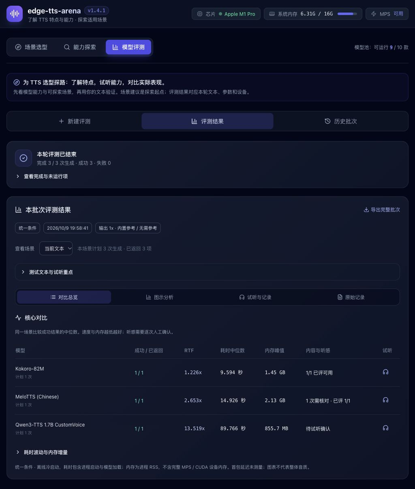

# edge-tts-arena

**PC 本地 TTS 能力探索与评测平台。** 把不同模型的特点、实际声音、生成耗时和进程内存放在同一个工作区，帮助开发者筛选适合自己应用的模型。

通过「场景选型 → 能力探索 → 模型评测」完成比较，支持同文本 A/B 试听、重复评测、性能图表和可导出的生成记录。

[快速启动](#快速启动) · [模型范围](#模型范围) · [怎样评测](#怎样评测) · [指标口径](#指标口径) · [现有验证数据](#现有验证数据) · [常见问题](#常见问题)

## 界面预览



截图来自已有三模型批次，用于展示结果、试听摘要和导出入口；其中的单次数据不代表完整模型排名。

## 可以做什么

| 工作区 | 用途 |
| --- | --- |
| 场景选型 | 按朗读、英文声音描述、对话、声音克隆、多语言、风格指令、目标时长寻找候选，查看使用条件与官方资料 |
| 能力探索 | 用自己的文本尝试模型专属音色、指令或参考声音，试听、下载并恢复历史设置 |
| 模型评测 | 选择模型、文本和重复次数，按统一条件或推荐配置串行运行，查看进度、失败与逐次结果 |
| 结果分析 | 比较耗时、RTF、内存的中位数与范围；查看柱状图、指标曲线与性能雷达 |
| 试听与记录 | 同场景 A/B 试听，人工记录正文完整性、自然度、表达与异常；导出音频和实际参数 |
| 历史管理 | 批次历史与生成历史均支持分页、移入回收站及恢复，保留原音频和参数 |

场景建议是探索起点，功能支持不等于该场景效果已验证。**性能图表比较资源开销，声音是否合适需要实际试听。** 当前尚未接入自动转写、MOS 或音质综合评分。

## 快速启动

当前本地验证设备为 **Apple M1 Pro / 16GB / macOS**。模型入口包含 CPU、MPS 或 CUDA 路径，具体策略因模型而异；其他 PC 环境需单独验证，现有脚本使用 Bash。

准备 Python 3.12、[uv](https://docs.astral.sh/uv/)、Node.js、pnpm；需要拉取官方源码的模型还使用 Git。部分模型需要 FFmpeg 及辅助资源，详见[模型准备与兼容性](docs/models.md)。以下命令均在项目根目录执行。

**系统默认 Python 无需统一。** M1 Pro 的 3.12 与 Mac mini M4 的 3.13 可以保留；项目新建 `.venv` 使用 3.12，各模型在 `.venvs/` 中使用指定的 3.12 或 3.11。Python 3.13 和 M4 的完整模型兼容性尚未验证，不能直接沿用 M1 的性能结果。准备方式见[跨机器 Python 环境](docs/models.md#跨机器-python-环境)。

### 启动平台

```bash
# 新建时使用 Python 3.12；已有 .venv 会保留
./scripts/setup_env.sh

cd frontend
pnpm install
pnpm run build
cd ..

./start.sh
```

打开 [http://127.0.0.1:8081](http://127.0.0.1:8081)，API 文档为 [http://127.0.0.1:8081/docs](http://127.0.0.1:8081/docs)。已有环境和前端构建时，直接运行 `./start.sh`。

**平台环境与模型环境分开。** 上述步骤只安装基础依赖和前端，不准备模型；缺少资源的模型显示「未就绪」，仍可查看能力资料。

初始化脚本不自动下载 Python 解释器。若本机只有 3.13，可手动运行 `uv python install 3.12` 后重试；无需更改系统 `python3`。已有非 3.12 的平台环境会提示并保留，不会自动删除或迁移。

### 按需准备模型

已有模型环境与权重可跳过此步。下面以 Kokoro 为例，**手动运行才会安装依赖、下载相关资源**：

```bash
# 准备独立模型环境
./.venv/bin/python scripts/setup_models.py --models kokoro

# 查看权重状态，再下载指定模型
./download.sh --list
./download.sh --models kokoro-82m
```

准备全部环境使用 `./.venv/bin/python scripts/setup_models.py --all`，覆盖 10 款模型所需的 9 个环境（两个 Qwen 版本共用一个）。准备多个环境时使用 `--models kokoro,melotts,qwen3`；下载时使用模型 key，例如 `--models kokoro-82m,melotts-zh,qwen3-tts-0.6b`。**环境名与模型 key 不同**，`qwen3` 环境供两个 Qwen 版本共用。ChatTTS、F5-TTS 也已包含在 `--all` 中，单独准备时用 `--models chattts,f5tts`。完整说明见[模型文档](docs/models.md)。

推理使用本地资源，不会在生成时自动补下载。未就绪原因以页面或 `GET /api/models` 为准，不仅检查主权重，还检查源码、模型环境和辅助资源。

### 开发模式

```bash
./start.sh --dev
```

前端为 [http://localhost:5173](http://localhost:5173)，后端为 `http://127.0.0.1:8081`，Vite 将 `/api` 代理到后端。修改前端后重新执行 `pnpm run build`，普通启动模式才会使用新的构建产物。

启动脚本默认监听 `0.0.0.0:8081`。需要只绑定本机时，可直接运行：

```bash
./.venv/bin/python -m uvicorn backend.app.main:app --host 127.0.0.1 --port 8081
```

## 模型范围

当前注册 10 个真实推理入口。下表说明**项目实际接入版本与可探索能力**，不表示质量排名或所有语言均已验证。

| 模型 / key | 当前接入版本与能力 | 独立环境名 |
| --- | --- | --- |
| Kokoro / `kokoro-82m` | v1.0；已有中英音色、同语言音色混合 | `kokoro` |
| MeloTTS / `melotts-zh` | Chinese；中文与中英混读、节奏控制 | `melotts` |
| ChatTTS / `chattts` | 0.2.5；口语对话、笑声与停顿标记、音色种子 | `chattts` |
| F5-TTS / `f5-tts` | 旧版 F5TTS_Base 1200000 + Vocos；参考声音、步数控制 | `f5tts` |
| CosyVoice 3 / `cosyvoice3` | 0.5B-2512；参考克隆、跨语言、风格指令 | `cosyvoice3` |
| Qwen3-TTS / `qwen3-tts-0.6b` | 12Hz 0.6B Base；完整克隆或仅提取音色 | `qwen3` |
| Qwen3-TTS / `qwen3-tts-1.7b` | 12Hz 1.7B CustomVoice；9 种预置音色与风格指令 | `qwen3` |
| Fish-Speech / `fish-speech-1.5` | 1.5 权重、v1.5.1 源码；参考音色、采样控制 | `fish-speech` |
| MaskGCT / `maskgct` | 两阶段本地权重；参考声音、目标时长与步数 | `maskgct` |
| Parler-TTS / `parler-tts-mini` | Mini v1；英文描述式生成、6 个命名说话人快捷选项，无参考克隆 | `parler` |

2026-10-09 已有九款模型的真实生成记录；2026-10-11 使用用户补齐的 Parler 资源完成英文生成验证。当前十款均有生成记录，资源状态仍由平台实时检查；这些记录不构成同条件横评。版本、设备策略和辅助资源详见[模型文档](docs/models.md)。

## 怎样评测

1. **选候选**：在场景选型中查看模型条件；准备示例不会自动生成。
2. **试能力**：在能力探索中输入正文，选择音色、参考或指令，确认实际声音。
3. **建批次**：选择已有且就绪的模型，使用自定义文本或场景测试集，设置重复次数。
4. **读结果**：按场景查看资源指标与原始结果，用同文本 A/B 试听核对内容，保存人工记录。
5. **留依据**：导出完整批次、逐次参数与音频；以后从历史重新查看，或点击「使用这些条件」准备复测。

### 两种比较方式

| 方式 | 配置与用途 |
| --- | --- |
| 统一条件 | 同目标文本、基础预设；模型生成速度 1.0，再统一处理输出变速。关闭 ChatTTS 台词润色，Qwen CustomVoice 保留无指令输出 |
| 推荐配置 | 同目标文本，采用部分模型的探索起点：Qwen 1.7B 清晰播报、CosyVoice 温暖讲述、ChatTTS 自然对话，其余基础预设 |

需要参考音频的模型共享本轮参考与配套原文；预置音色模型不使用参考。算法、默认音色和生成方式仍有差异，两种方式的结果应分别判断。探索设置与评测设置独立，实际配置记录在每份音频旁。

场景测试集包含英文提示、短提示、长段落、数字日期、多音字、中英混读、情绪对话。选择测试集时只运行所选样本，不使用自定义文本。界面支持每段重复 1 / 2 / 3 / 5 次（API 支持 1–5），任务总数为「模型数 × 文本数 × 重复次数」。固定默认种子用于观察运行波动，不是不同种子的稳定性评测。Parler Mini v1 仅支持英文；包含它时使用英文正文或单选「英文提示」，界面提前拦截不支持的文字，不自动翻译或替换某个模型的评测正文。

批次串行执行，失败不阻断后续项。进度按已返回任务数计算；「停止后续生成」会保留当前这次的完成结果，并跳过后续任务。重试失败项会创建关联的新批次，原记录保留。服务重启后保留已完成结果，未结束批次标为中断，不自动续跑。

更多统计规则、图表说明和 API 示例见[评测与记录文档](docs/evaluation.md)。

## 指标口径

| 指标 | 含义与限制 |
| --- | --- |
| 离线耗时 | 包含推理进程启动、模型加载、合成及选用的输出变速；不含排队和最终输出文件保存 |
| RTF | 离线耗时 ÷ 最终音频时长；包含冷启动成本，不能代替常驻模型的稳态速度或交互延迟 |
| 内存峰值 | 后端及子进程 RSS 总和，每 50ms 采样；可能漏过短时峰值，不代表完整 MPS / CUDA 设备内存 |
| 内存增量 | 本次采样内存峰值减去运行前基线，最低记 0；不是结束时内存减去基线 |
| 音频时长 | 最终输出音频时长；过短检查不能证明正文完整 |
| 首包延迟 | 当前无流式输出，值为 `null`，界面显示 `--` |

失败项不进入性能统计，未返回项不计入成功率分母。成功仅表示该次生成通过程序检查；正文准确性和听感由人工记录独立表达，不进入性能雷达或资源排名。

## 现有验证数据

**已有部分真实结果，尚未完成十款模型的完整统一横评。** 不把接入成功、有效音频和音质通过当作同一件事。

| 已有证据 | 可以说明什么 | 不能据此推断什么 |
| --- | --- | --- |
| 九款模型生成与定制验证 | 已有资源可运行对应推理入口，并产出有效音频 | 条件不同，不能拼成公平性能排名；未完成全面听评 |
| Parler Mini v1 默认英文 / Jon＋温暖讲述 | 两次在 MPS 上生成有效音频，记录实际描述、种子和精度 | 仍需人工核对正文、自然度与描述响应；不是十款统一结果 |
| Kokoro / MeloTTS，2 段文本 × 2 次，共 8 次 | 同场景、同配置下的耗时、RTF 与进程内存比较 | 样本少，不能推断长期稳定性或其他 PC 的性能 |
| 三款模型单次统一批次 | 该文本与设备上的单次对照 | 不能当作多轮统计或十款综合结果 |
| Qwen 1.7B 开头发声 A/B 反馈 | 清晰播报指令在已确认样本中缓解了额外“哦”，正文完整 | 根因未确认，不能保证其他文本、音色均解决 |

本地记录位于 `outputs/`：[生成验证](outputs/local_models_report.md)、[八次场景评测](outputs/ui-v1.3-report.md)、[Qwen 对照调查](outputs/qwen-onset-20261009/diagnosis.md)。整个目录属于本机生成产物，已加入 Git 忽略，不随源码提供；上述链接仅在保有这些记录的本机可用。在自己的设备上复测后，使用自己的音频与参数判断。

旧版模拟跑分不能作为真实模型性能依据。完整横评需要补齐同条件、多次生成和对应试听记录。

## 音频、参考与历史

未上传参考音频时，F5-TTS、CosyVoice、Qwen Base、Fish-Speech、MaskGCT 使用项目内置中文参考和配套原文。可先试听默认参考，再决定是否上传；来源与许可见 [SOURCE.md](backend/assets/reference/SOURCE.md)。

上传参考通常要同时填写原话；Qwen Base 的仅音色模式、CosyVoice 的跨语言模式允许省略原文。上传音频只在当次任务中临时使用，历史恢复时需重新上传，或明确改用默认参考。

每次成功生成保存：

```text
outputs/
├── <model>_<id>.wav           # 原音频
├── <model>_<id>.run.json      # 文本、版本、音色、实际参数、参考信息、设备与指标
├── <model>_<id>.review.json   # 已保存的人工试听记录（如有）
├── comparisons/<job_id>.json # 完整批次
└── .run-history/             # 生成历史的删除 / 恢复状态
```

两类历史均支持每页 5 / 10 / 20 / 50 条。删除移入可恢复的回收站，保留音频、参数和试听文件；生成历史的删除不影响原评测批次，运行中的批次不能删除。查看历史结果保留待运行设置，「恢复设置」或「使用这些条件」才会改变配置。

未保存的试听草稿仅保留在当前页面会话，切换页面后可继续编辑；刷新或关闭前需要保存。已有试听文件损坏时明确报错，避免把损坏误当作空记录并覆盖。

## 常见问题

| 问题 | 检查方向 |
| --- | --- |
| 下载了权重仍显示未就绪 | 检查对应 `.venvs/`、官方源码、辅助模型及文本资源；按页面缺失原因处理 |
| 页面没有更新或显示 API 信息 | 普通模式依赖 `frontend/dist/`；重新构建，或使用 `--dev` 模式 |
| 模型速度没有明显改变 | 有些模型使用原生速度，有些使用离散档位或输出变速；查看实际参数中的 `speed_kind`、`worker_speed` |
| 生成声音很短、重复或发音异常 | 先核对文本、参考原文与当前模型配置，再试听；有效音频检查不能判断语义正确 |
| 相同种子仍有差别 | 种子有助于复现，不保证跨设备、精度、环境或版本完全一致 |
| MPS 可用但某些模型仍使用 CPU | 当前设备策略按模型选择，详见[兼容性说明](docs/models.md#设备与兼容性) |

## 项目结构与开发

前端为 Vue 3 + TypeScript + Vite + Tailwind CSS，后端为 FastAPI；模型在独立 Python 环境的子进程中真实推理。平台与 CLI 共用跨进程推理锁，避免同时加载多个大模型。

```text
frontend/src/           界面、场景、图表、A/B 试听与草稿管理
backend/app/api/        生成、评测、历史与试听记录接口
backend/app/adapters/   状态检查、模型适配与子进程管理
backend/app/workers/    真实模型推理入口
backend/app/core/       配置、统计、参考音频与记录保存
backend/assets/         内置参考素材
scripts/                环境准备、下载与命令行评测
tests/                  后端回归检查
docs/                   模型准备、评测说明与截图
checkpoints/            本地权重（不随源码提供）
.venv/                  平台环境
.venvs/                 模型环境
third_party/            固定版本官方源码
outputs/                本机生成音频与评测记录
```

### 命令行评测

指定已有模型，避免一次运行全部模型：

```bash
./.venv/bin/python scripts/benchmark.py --type short --models kokoro-82m,melotts-zh

# 包含英文专用 Parler 时，统一使用英文正文
./.venv/bin/python scripts/benchmark.py --type english --models kokoro-82m,parler-tts-mini

# 使用自定义参考音频
./.venv/bin/python scripts/benchmark.py --type bilingual --models f5-tts \
  --ref-audio /absolute/path/reference.wav --ref-text '参考音频所说的原话'
```

CLI 使用统一条件，支持 `short`、`english`、`bilingual`、`prosody` 四种文本；默认覆盖 `outputs/benchmark_report.md`，原始音频和参数独立保存。某个模型失败不会中断其他项，全部失败时退出码为非零。多场景、多轮次评测使用界面或[批次 API](docs/evaluation.md#批次-api)。

### 检查

```bash
./.venv/bin/python -m unittest discover -s tests -v

cd frontend
pnpm run test:statistics
pnpm run test:drafts
pnpm run test:listening-summary
pnpm run test:language
pnpm run build
```

已有回归检查覆盖请求校验、资源检查、真实推理入口调用、离线配置、互斥、批次状态与持久化、统计、试听记录和历史删除恢复。程序检查不代替人工音质评审。

## 许可证

平台代码采用 [MIT](LICENSE)。模型权重、官方源码与辅助资源分别遵循其自身许可证，使用与分发前请核对实际版本。内置参考素材保留[来源说明](backend/assets/reference/SOURCE.md)和[原许可证](backend/assets/reference/LICENSE)。
